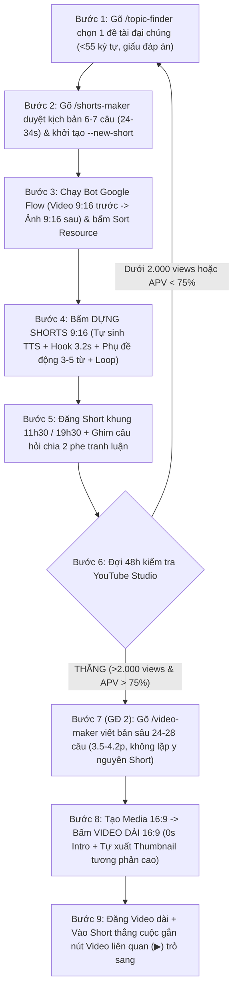

# QUY TRÌNH SẢN XUẤT 1 VIDEO MỚI TỪ A–Z (FLOW V3 — VẮT CHANH CÔNG NGHỆ)

> **Định vị kênh**: *“Vắt sạch thông số, giữ lại cách dùng”* — Nền kem ấm `#FAF7F2`  
> **Trục khán giả khóa cứng 30 ngày**: **Điện • Di động • Sạc nhanh • Xe điện • Wi-Fi** *(Độ phủ đại chúng `>=80%`; cấm nhảy sang lọc nước/bếp núc; cấm đăng 2 bài liên tiếp trùng 1 món đồ).*

---

## Tổng Quan Luồng Vận Hành 2 Giai Đoạn



---

## GIAI ĐOẠN 1: LÀM 1 YOUTUBE SHORT `9:16` DÒ ĐƯỜNG (`24–34 GIÂY`)
*(Mục tiêu: Ra đều đặn **1 Short/ngày**, tốn `<15 phút` thao tác sau khi có media).*

### Bước 1: Tìm & Chọn Đề Tài Đại Chúng (`/topic-finder`)
1. Mở khung chat AI trong workspace này, gõ:
   - `/topic-finder` *(để AI tự quét kho `projects/` và đề xuất 5 chủ đề xoay vòng)*, hoặc
   - `/topic-finder củ sạc nhanh` / `/topic-finder pin điện thoại` / `/topic-finder wifi phòng ngủ`.
2. **Kiểm tra 3 tiêu chí trước khi chốt số `1–5`**:
   - Đồ vật mà **80% người Việt đang cầm hàng ngày** (củ sạc, dây cáp, pin điện thoại, sạc dự phòng, Wi-Fi, xe điện).
   - **Tiêu đề `<55 ký tự`, tuyệt đối KHÔNG lộ kết quả** (VD: *"Cái Bẫy Ẩn Sau Củ Sạc 65W Giá 150K Vẫn Báo Sạc Siêu Nhanh"*).
   - Có sẵn **câu hỏi chia 2 phe** để lát nữa ghim dưới phần bình luận.

---

### Bước 2: Chốt Kịch Bản 6–7 Câu & Tạo Khung Dự Án (`/shorts-maker`)
1. Sau khi bạn chọn số (VD: chọn số `1`, mã dự án `gan_charger_150k_trap`), AI kích hoạt `/shorts-maker` viết bản nháp **6–7 câu** (`10–15 từ/câu`, tổng `~75–95 từ` -> đọc ở tốc độ `1.18x` ra đúng **`25–32 giây`**):
   - **Câu 01 (`[VIDEO]`, 0–3s)**: Cận cảnh hiện tượng thật + con số mất tiền/hại máy.
   - **Câu 02–05 (`1 [VIDEO]` + `3 [IMG]`)**: Cưa đôi linh kiện giải phẫu cơ chế vật lý + mẹo kiểm tra 3 giây.
   - **Câu 06 (`[VIDEO]`)**: Nhắc Đăng ký `1.5s` gắn lợi ích ví tiền + câu bỏ lửng nối mượt ngược về Câu 01 (Seamless Loop).
2. **Duyệt kịch bản (Stop Gate)**: Đọc lướt 6 câu. Nếu ưng ý, nhắn `"Chốt kịch bản"`.
3. Ngay sau khi chốt, AI tự động khởi tạo thư mục `projects/<slug>/` (hoặc bạn bấm **`+ Tạo Dự Án Mới`** tích sẵn *Chuẩn Shorts-First 9:16* trên `run_studio.bat`) gồm:
   - `script_short_vi.txt` *(6–7 câu thoại)*
   - `prompts_short_vi_video.txt` *(2–3 câu prompt `.mp4` dọc `--ar 9:16`, có nhãn `# Cảnh 01`, `# Cảnh 03`, `# Cảnh 06`)*
   - `prompts_short_vi_img.txt` *(3–4 câu prompt ảnh tĩnh dọc `--ar 9:16`, có nhãn `# Cảnh 02`, `# Cảnh 04`, `# Cảnh 05`)*
   - `shorts_config_vi.json` *(Cấu hình tiêu đề Hook 3.2s, màu nhấn, 3 tiêu đề YouTube, mô tả, comment ghim — không có nhãn `Tập 1/4`)*
   - `video_short_vi/` *(Thư mục rỗng chờ bỏ media tải về)*

---

### Bước 3: Sinh Media Dọc `9:16` Trên Google Flow & Sắp Xếp Tự Động
Mở công cụ giao diện đồ họa bằng cách chạy **`run_studio.bat`** (hoặc `python app.py`):

1. **Chạy lượt Video `.mp4` trước (`prompts_short_vi_video.txt`)**:
   - Qua tab **`🌐 Bot Google Flow`** -> Chọn file `projects/<slug>/prompts_short_vi_video.txt` -> Chọn mức chờ **`Chậm / Video Veo (45 - 60s)`** -> Bấm **`▶ Khởi Động Bot`**.
   - Trên cửa sổ Chrome hiện ra: chuyển Google Flow sang chế độ **Video** và khổ dọc **`9:16` (Portrait)** -> Bấm nút xanh **`🚀 Sẵn Sàng`**.
   - Khi Flow tạo xong 2–3 clip `.mp4`, tải lần lượt từ trên xuống dưới (đúng thứ tự câu prompt) vào thẳng thư mục `projects/<slug>/video_short_vi/`.
2. **Chạy lượt Ảnh tĩnh `.png`/`.jpg` sau (`prompts_short_vi_img.txt`)**:
   - Chọn file `projects/<slug>/prompts_short_vi_img.txt` -> Đổi mức chờ sang **`Nhanh - Ảnh (15 - 20s)`**.
   - Trên Google Flow: chuyển sang chế độ **Image** khổ dọc **`9:16` (Portrait)** -> Bấm **`🚀 Sẵn Sàng`**.
   - Tải lần lượt 3–4 ảnh về cùng thư mục `projects/<slug>/video_short_vi/` *(giữ nguyên dấu nhận diện AI theo quy định nền tảng)*.
3. **Đánh số tự động bằng 1 cú click (`🔀 Sort Resource`)**:
   - Quay lại tab **`🎬 Dựng Video (Render)`** -> Chọn dự án `<slug>` -> Bấm **`🔀 Sort Resource`**.
   - Tool tự động đọc nhãn `# Cảnh XX` trong 2 file prompt và đổi tên toàn bộ 6 file trong `video_short_vi/` thành `01_...mp4`, `02_...png`, ..., `06_...mp4`.
   - Kiểm tra dòng trạng thái báo: `🖼️ 6 media (video_short_vi) | 📝 6 câu (script_short_vi.txt)` *(hai con số bắt buộc bằng nhau)*.

---

### Bước 4: Render Short `9:16` + Kiểm Tra & Tinh Chỉnh Nhanh
1. **Kiểm tra rủi ro rớt view trước khi dựng (Tùy chọn bằng CLI)**:
   ```bash
   python .agents/skills/shorts-maker/scripts/build_shorts.py <slug> --dry-run
   ```
   *(Đảm bảo không có cảnh báo `[RETENTION RISK]` nào như: mở đầu bằng ảnh tĩnh, quá 38 giây, dính chữ `Tập 1/4`, hay lộ đáp án).*
2. **Bấm dựng thành phẩm**:
   - Trên Studio: Chọn giọng đọc (mặc định `Gemini 3.8 - Tech Baritone`) -> Bấm nút xanh lá **`📱 DỰNG SHORTS 9:16 (DÒ ĐƯỜNG)`**.
   - *(Hoặc CLI)*: `python .agents/skills/shorts-maker/scripts/build_shorts.py <slug>`
3. **Hệ thống tự động xử lý từ A–Z**:
   - Gọi Gemini TTS tạo giọng đọc vào `audio_short_vi/` (gộp 5 câu/request, tự xoay model nếu chạm quota).
   - Tách câu thoại thành từng cụm **3–5 từ** nhảy theo nhịp nói, tô nổi bật con số & đơn vị, gài hiệu ứng `whoosh`/`pop` + nhạc nền `124 BPM`, gắn Banner Hook chỉ hiện đúng **`3.2s` đầu** rồi ẩn đi, và nối **Seamless Loop** cuối bài.
   - Xuất trọn bộ vào `projects/<slug>/shorts_vi/`:
     - `<id>.mp4` *(Video Short `1080x1920` hoàn chỉnh)*
     - `<id>_thumb.jpg` *(Ảnh bìa dọc `9:16`)*
     - `<id>_dang_bai.txt` & `TONG_HOP_DANG_SHORTS.md` *(3 phương án tiêu đề, mô tả, hashtag, bình luận ghim)*
4. **Mẹo sửa nhanh nếu nghe phát âm chưa ưng (Không tốn lại Quota)**:
   - Nếu AI đọc sai 1 từ viết tắt tiếng Anh -> Thêm từ đó vào [resources/pronunciation_vi.json](file:///c:/Workspace2/Video/resources/pronunciation_vi.json) (chỉ đổi âm đọc, phụ đề trên màn hình vẫn giữ nguyên chữ gốc!).
   - Nếu phụ đề ngắt đôi 1 từ ghép -> Thêm từ ghép đó vào [resources/vi_compound_words.txt](file:///c:/Workspace2/Video/resources/vi_compound_words.txt).
   - Nếu muốn sửa lời Câu 03 -> Mở `script_short_vi.txt` sửa đúng dòng `03.`, **KHÔNG tích** ô *Ép tạo lại Audio*, bấm lại **`📱 DỰNG SHORTS 9:16`** -> hệ thống chỉ sinh lại âm thanh đúng câu `03.` nhờ bộ nhớ đệm `tts_manifest.json`!

---

### Bước 5: Checklist Đăng Short Lên YouTube (Khung Giờ Vàng `11h30` hoặc `19h30`)
1. Mở file `projects/<slug>/shorts_vi/<id>_dang_bai.txt`, chọn 1 tiêu đề `<65 ký tự` gây tò mò nhất (kèm `#shorts`), dán mô tả.
2. Chọn ảnh bìa từ `<id>_thumb.jpg` (hoặc chọn khung hình bắt mắt nhất của Cảnh 01 trên điện thoại).
3. Trong mục cài đặt YouTube Studio: **Bật nhãn khai báo *"Nội dung bị thay đổi hoặc tổng hợp" (Altered or synthetic content)***.
4. **Ngay lập tức sau khi xuất bản**: Copy câu hỏi *"Mồi tranh luận 2 phe"* trong `_dang_bai.txt` dán vào phần Bình luận và bấm **Ghim (Pin)** để kích người xem tranh luận ngay từ những lượt hiển thị đầu tiên!

---

## GIAI ĐOẠN 2: BUNG VIDEO DÀI `16:9` CHO CHỦ ĐỀ THẮNG CUỘC
*(Chỉ kích hoạt sau **48 giờ** nếu Short ở Giai đoạn 1 vượt **`> 2.000 views`** và tỷ lệ xem trung bình **`APV > 75%`**. Tần suất mục tiêu: **1–2 Video dài/tuần**).*

### Bước 6: Mở Rộng Kịch Bản Sâu `24–28 Câu` (`/video-maker`)
1. Gõ `/video-maker <slug>` trong khung chat AI.
2. AI viết kịch bản dài **`24–28 câu`** (`10–16 từ/câu`, nhịp nhanh `<7 giây/cảnh`, tổng thời lượng `3.5–4.2 phút`):
   - **Không bê nguyên xi 6 câu Short kéo giãn**: bổ sung bảng đo thực tế, các trường hợp ngoại lệ, bài toán chi phí 3 năm và chèn câu nhắc Đăng ký ở giữa bài (câu 14–16).
   - Chốt kèm **Tiêu đề `<55 ký tự`** và **2 dòng chữ cực đại cho Thumbnail 16:9** (`3–4 từ/dòng`, không trùng tiêu đề).
3. Sau khi bạn duyệt chốt, AI lưu `script_vi.txt`, `prompts_vi_video.txt` (`6–8 cảnh --ar 16:9`) và `prompts_vi_img.txt` (`16–20 cảnh --ar 16:9`) vào chung thư mục `projects/<slug>/`.

---

### Bước 7: Tạo Media Ngang `16:9` & Render Video Dài (0s Intro + Auto Thumbnail)
1. Dùng tab **`🌐 Bot Google Flow`** đẩy `prompts_vi_video.txt` (chế độ **Video `16:9` Landscape**) rồi đến `prompts_vi_img.txt` (chế độ **Image `16:9` Landscape**).
2. Tải toàn bộ 24–28 file vào `projects/<slug>/video_vi/` -> Qua tab Render bấm **`🔀 Sort Resource`**.
3. Dựng Video dài + Thumbnail tương phản cao:
   - Trên Studio: Bấm **`🎬 VIDEO DÀI 16:9`** *(hoặc dùng CLI để truyền trực tiếp 2 dòng chữ bìa)*:
     ```bash
     python make_video.py <slug> --thumb-top "BÁO SẠC SIÊU NHANH" --thumb-bottom "NHƯNG RỖNG RUỘT?!"
     ```
   - Xuất ra `<slug>_vi.mp4` (**vào thẳng cảnh Hook ở giây `00:00`, không vướng 3s Intro logo**) và ảnh bìa `thumbnail_vi.jpg` phủ nền tối tương phản bên trái + chữ siêu lớn đọc rõ trên điện thoại.

---

### Bước 8: Khép Kín Phễu Kéo View Từ Short Sang Video Dài
1. Đăng `<slug>_vi.mp4` lên kênh kèm ảnh bìa `thumbnail_vi.jpg`, thông tin trong `youtube_vi.md`, và bật nhãn *Nội dung bị thay đổi hoặc tổng hợp*.
2. Mở lại trang chỉnh sửa của **video Short thắng cuộc** trong YouTube Studio -> Tìm mục **Video liên quan (Related Video)** -> Chọn trỏ thẳng vào **Video dài `<slug>_vi.mp4`** vừa đăng!
3. Cập nhật lại bình luận ghim dưới Short: thêm dòng đầu `▶ Bấm vào nút Video liên quan góc dưới màn hình để xem bản cưa đôi thử nghiệm đầy đủ!` kèm câu hỏi thảo luận bên dưới.

---

## Bảng Tra Cứu Lệnh Nhanh (CLI Cheat Sheet)

| Thao tác | Câu lệnh chuẩn |
|---|---|
| Xem danh sách & trạng thái mọi dự án | `python make_video.py --list` |
| **[GĐ 1]** Tạo mới dự án Short `9:16` dò đường | `python make_video.py --new-short <slug>` |
| **[GĐ 1]** Kiểm tra lỗi Retention trước khi render Short | `python .agents/skills/shorts-maker/scripts/build_shorts.py <slug> --dry-run` |
| **[GĐ 1]** Render Short `9:16` + Thumbnail + Bài đăng | `python .agents/skills/shorts-maker/scripts/build_shorts.py <slug>` |
| **[GĐ 1]** Chỉ xuất lại Thumbnail & chữ đăng Short | `python .agents/skills/shorts-maker/scripts/build_shorts.py <slug> --meta-only` |
| **[GĐ 2]** Render Video dài `16:9` + Thumbnail chữ lớn | `python make_video.py <slug> --thumb-top "DÒNG 1" --thumb-bottom "DÒNG 2"` |
| Mở phần mềm giao diện đồ họa Studio | `run_studio.bat` |
