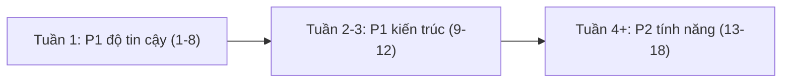

# Lộ trình dự án

> Nguồn: báo cáo review `plans/visuals/review-du-an-vat-chanh-cong-nghe-video-pipeline.md` (2026-11-27). Điểm tổng hiện tại ≈ **6.8/10**.

## 1. Đã hoàn thành

| Hạng mục | Kết quả |
|---|---|
| Flow V3 Shorts-first | Short 9:16 độc lập, Hook 3.2s, caption động 3–5 từ, Seamless Loop, audit retention `--dry-run` |
| Video dài tối ưu retention | Tắt intro mặc định, tự xuất thumbnail 16:9 |
| Cache TTS theo hash nội dung | `core/tts_cache.py` + test — sửa câu nào chỉ tạo lại câu đó |
| Phụ đề giữ từ ghép, từ điển phát âm | `core/vi_text.py`, `resources/vi_compound_words.txt`, `resources/pronunciation_vi.json` |
| Console UTF-8 | Không còn crash khi log tiếng Việt |
| Gỡ kênh tiếng Anh | Chỉ còn `vi` |
| Tuân thủ | Gỡ tab xóa watermark, thêm `resources/CREDITS.md`, nhắc bật nhãn nội dung AI trong `*_dang_bai.txt` |
| Dọn V2 | `make_shorts.py` 1508 → 692 dòng; cấu hình `lfp_vs_ncm` chuyển sang JSON |
| Test | 5 → 25 test |
| Tài liệu | Bộ `docs/` này |

## 2. Việc tiếp theo

### P1 — Độ tin cậy & DX

| # | Việc | Công sức | Tiêu chí xong |
|---|---|---|---|
| 1 | Điền nguồn/license trong `resources/CREDITS.md` | 1 giờ | Không còn ô "Cần điền" |
| 2 | Bổ sung `numpy`, `scipy` vào `requirements.txt`, pin phiên bản | 1 giờ | Cài mới trên máy sạch chạy được |
| 3 | `requirements-dev.txt` (pytest, ruff), gom test về `tests/` | 0.5 ngày | 1 lệnh chạy toàn bộ test |
| 4 | CI GitHub Actions trên Windows runner | 0.5 ngày | `ruff check` + test xanh mỗi push |
| 5 | `logging` + file `projects/<slug>/render.log`; bỏ `except: pass` ở chỗ đọc config | 1 ngày | Lỗi render có log để xem lại |
| 6 | Ghép `full_voiceover.mp3` bằng FFmpeg concat thay vì nối byte | 2 giờ | File ghép có header/thời lượng đúng |
| 7 | Validate đầu vào video dài giống `--dry-run` của Short | 0.5 ngày | Báo lỗi trước khi gọi TTS |
| 8 | Bọc `auto_flow.py` trong `main()` | 1 giờ | Import không gây side-effect |

### P1 — Kiến trúc

| # | Việc | Tiêu chí xong |
|---|---|---|
| 9 | Chuyển `build_shorts.py` + `make_shorts.py` vào `core/shorts/` (`overlay.py`, `captions_png.py`, `thumbnail.py`, `scene.py`, `pipeline.py`) | Script trong `.agents/skills/` chỉ còn vài dòng gọi `main()` |
| 10 | Tách `app.py` mỗi tab 1 file | Không file nào > 400 dòng |
| 11 | Chẻ hàm > 100 dòng (`build_shorts`, `render_project`, `render_short_thumbnail`) | Mỗi bước có tên riêng, test được |
| 12 | CLI thống nhất (`vct new | short | long | thumb`) | 1 entry point |

### P2 — Tính năng

| # | Việc | Lợi ích |
|---|---|---|
| 13 | Chuẩn hóa loudness (`loudnorm` ~ −14 LUFS) + sidechain ducking BGM | Âm thanh đều giữa các video |
| 14 | Forced alignment phụ đề (Whisper word timestamps) | Caption khớp từng từ — khác biệt lớn với Short |
| 15 | Upload qua YouTube Data API (tiêu đề, mô tả, thumbnail, lịch 11h30/19h30) | Bớt thao tác tay |
| 16 | Kéo số liệu YouTube Analytics, tự đánh dấu Short đạt `2.000 views & APV > 75%` | Tự động hóa quyết định làm video dài |
| 17 | Render manifest (commit, voice, model thực dùng, hash media) | Debug "vì sao bản này khác bản trước" |
| 18 | Checklist fact-check + mục "Nguồn" trong mô tả | Giữ uy tín kênh "vắt sạch thông số" |

## 3. Mốc thời gian (ước lượng)

| Mốc | Điều kiện đạt |
|---|---|
| M1 — Ổn định | CI xanh, có log file, requirements tái lập được |
| M2 — Gọn | Không file > 400 dòng, 1 CLI |
| M3 — Chuyên nghiệp | Loudness chuẩn, phụ đề khớp từ, đăng + đo tự động |

## 4. Cần người quyết định

- Đối chiếu điều khoản hiện hành của Google (Flow, ảnh AI) và YouTube (khai báo nội dung tổng hợp) cho bot Flow.
- Xác nhận repo có từng push public không (ảnh hưởng việc xóa lịch sử git cho file nhạc).
- Kiểm chứng mức −14 LUFS trên chính video của kênh.
