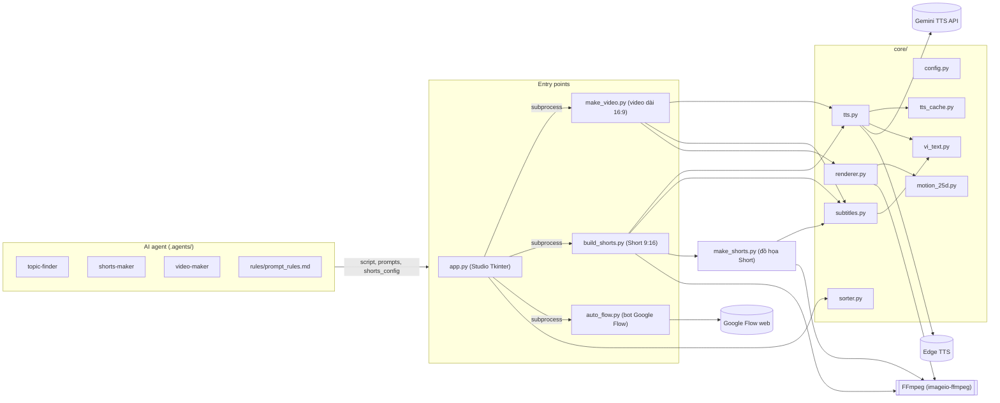
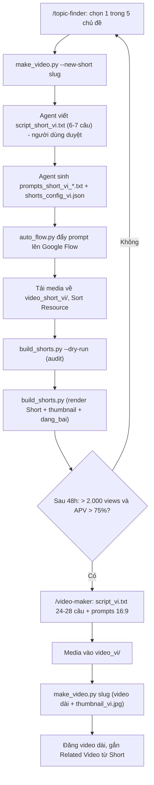
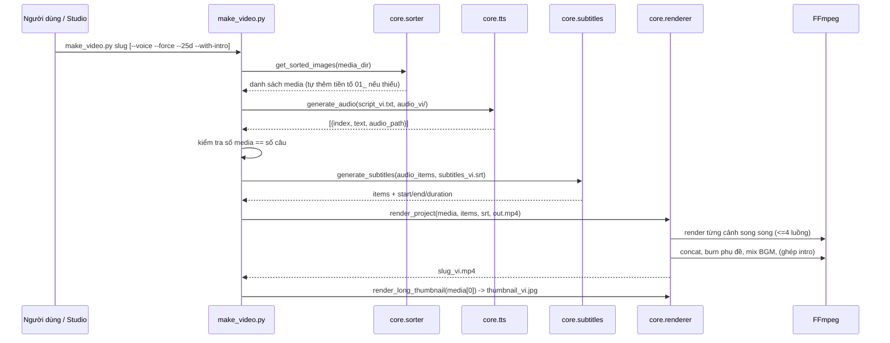
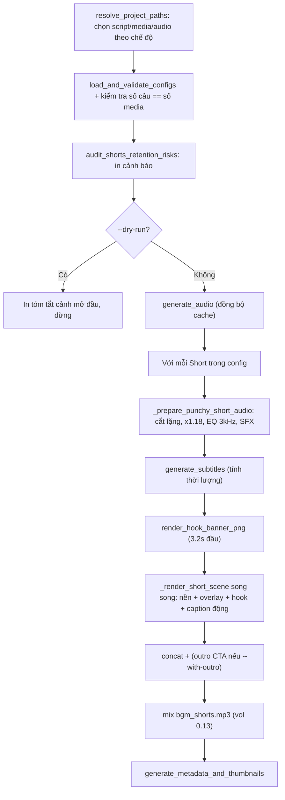
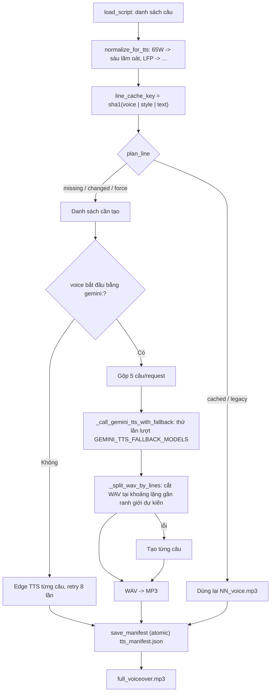
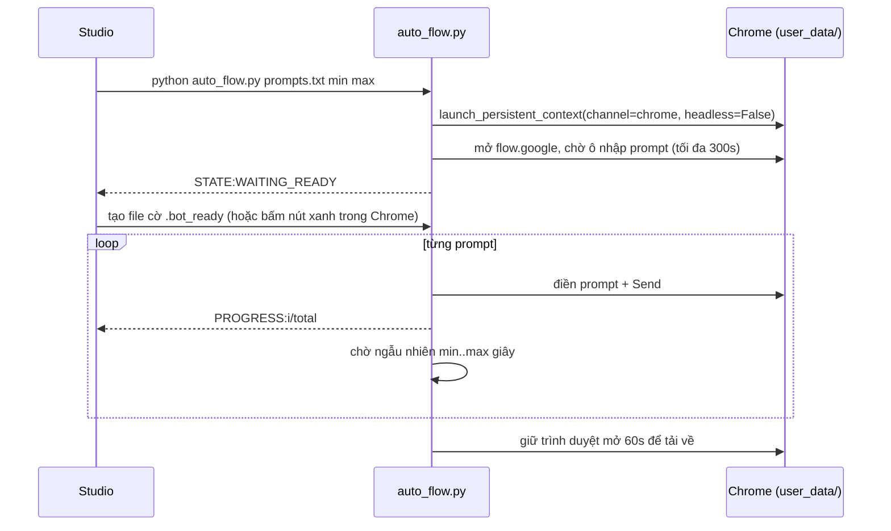

# Kiến trúc hệ thống

## 1. Bức tranh tổng thể

Hệ thống là một pipeline **file-based**: mọi bước đọc/ghi file trong `projects/<slug>/`. Không có database, không có server. Mỗi entry point là một script Python độc lập; Studio (`app.py`) chỉ gọi lại các script đó bằng `subprocess`.

## 2. Luồng nghiệp vụ 2 giai đoạn

## 3. Pipeline video dài (`make_video.py`)

Chi tiết render từng cảnh (`_render_single_scene`):

| Loại media | Xử lý |
|---|---|
| Video (`.mp4/.mov/.webm/...`) | Scale + crop về khung đích, lặp (`-stream_loop -1`) và cắt đúng thời lượng câu thoại |
| Ảnh, tắt 2.5D (mặc định) | Ken Burns: zoom vào/ra xen kẽ tối thiểu 8%, kèm trôi ngang nhẹ |
| Ảnh, bật `--25d` | `rembg` tách tiền cảnh, lấp lỗ nền (`distance_transform_edt`), 2 lớp zoompan lệch nhau tạo parallax |

Độ phân giải đích lấy từ **media đầu tiên**: ảnh dọc → 1080x1920, còn lại → 1920x1080. FPS 25.

## 4. Pipeline Short 9:16 (`build_shorts.py`)

Bố cục khung 1080x1920:

| Nguồn media | Bố cục |
|---|---|
| Dọc (cao > rộng) | **Full-bleed** 1080x1920 |
| Ngang | Nền mờ (`boxblur`) phủ lớp kem `#FAF7F2` 76% + khung hero `1048x740` |
| Hook banner | Overlay tại `y=152`, chỉ hiện `0..3.2s` cảnh 1 |
| Caption động | PNG 3–5 từ, overlay tại `y=1205`, thời điểm theo `compute_caption_cue_timings` |

Chọn chế độ trong `resolve_project_paths`:

- Có `script_short_vi.txt` và config không tham chiếu cảnh vượt số câu → **Shorts-first**: media `video_short_vi/`, audio `audio_short_vi/`.
- Ngược lại → **Repurpose 16:9 → 9:16**: dùng `script_vi.txt`, `video_vi/`, `audio_vi/`.

## 5. Hệ thống TTS

Điểm chính:

- Phụ đề giữ **nguyên văn kịch bản**; chỉ phần đọc được chuẩn hóa phát âm.
- Model không thuộc dòng 3.8 không hỗ trợ voice tùy biến và `speech_metadata` → tự đổi sang voice `Charon`.
- Client Gemini đặt `retry attempts=1` để không bị treo nhiều giờ theo header `Retry-After` khi gặp 429.

## 6. Bot Google Flow (`auto_flow.py`)

Giao tiếp Studio ↔ bot qua **stdout** (`STATE:`, `PROGRESS:`) và **file cờ** `.bot_ready` ở thư mục gốc.

## 7. Studio (`app.py`)

Class `VatChanhStudioApp` (Tkinter, theme tối) gồm 2 tab:

| Tab | Chức năng | Gọi tới |
|---|---|---|
| 🎬 Dựng Video | Chọn/tạo dự án, chọn giọng + nghe thử, nghe BGM/mix, đổi BGM, mở media/kịch bản, Sort Resource, dựng Short, dựng video dài, hủy render, thanh tiến độ | `build_shorts.py`, `make_video.py`, `core.sorter`, `core.tts.synthesize_preview` |
| 🌐 Bot Google Flow | Chọn file prompt, khoảng chờ, khởi động / sẵn sàng / dừng bot, log chi tiết | `auto_flow.py` |

Trạng thái giao diện (dự án cuối, giọng, khoảng chờ…) lưu tại `app_settings.json` (bị `.gitignore`). Cache nghe thử giọng nằm ở `user_data/preview_cache/`.

## 8. Phụ thuộc ngoài

| Phụ thuộc | Vai trò | Ghi chú |
|---|---|---|
| `google-genai` | Gemini TTS qua Interactions API | Cần biến môi trường API key |
| `edge-tts` | TTS dự phòng (voice `*-Neural`) | Không cần key |
| `imageio-ffmpeg` | Binary FFmpeg đi kèm | Không cần cài FFmpeg hệ thống |
| `Pillow` | Vẽ overlay, banner, caption, thumbnail | Font Segoe UI (Windows) |
| `rembg[cpu]` + `scipy` + `numpy` | Tách nền 2.5D | Tải model ONNX lần đầu |
| `playwright` | Điều khiển Chrome cho bot Flow | Cần Google Chrome đã cài |
| `tkinter`, `winsound` | Studio | Chỉ chạy trên Windows |
