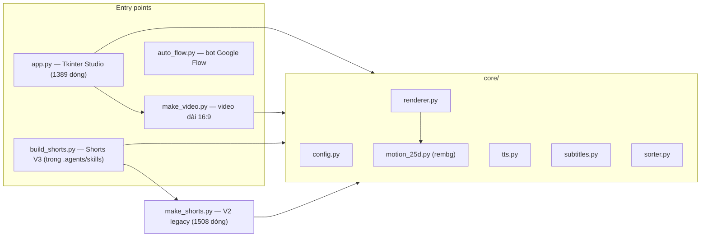
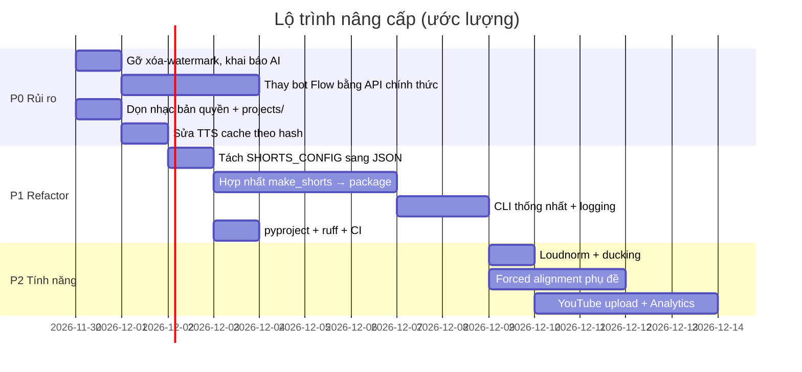

# Review dự án: Vắt Chanh Công Nghệ — Video Pipeline

> Ngày review: 2026-11-27 · Phạm vi: toàn bộ repo `C:\Workspace2\Video` (≈6.100 dòng Python, 121 file tracked)
> Trạng thái test: `test_build_shorts.py` — **5/5 pass** (chạy bằng `unittest`, `pytest` chưa được cài)

---

## 1. Tổng quan nhanh

```
┌───────────────┐   ┌──────────────┐   ┌─────────────────┐   ┌──────────────┐   ┌───────────────┐
│ topic-finder  │──>│ script_*.txt │──>│ TTS (Gemini +   │──>│ Subtitles /  │──>│ FFmpeg render │
│ (agent skill) │   │ prompts_*.txt│   │ fallback, Edge) │   │ captions     │   │ 9:16 / 16:9   │
└───────────────┘   └──────┬───────┘   └─────────────────┘   └──────────────┘   └───────┬───────┘
                           │                                                            │
                    ┌──────▼───────┐                                            ┌───────▼───────┐
                    │ auto_flow.py │  (bot Playwright → Google Flow)            │ Thumbnail +   │
                    │ media gen    │                                            │ metadata .txt │
                    └──────────────┘                                            └───────────────┘
```



---

## 2. Bảng điểm

| Hạng mục | Điểm | Nhận xét ngắn |
|---|---|---|
| Chức năng end-to-end | **8/10** | Pipeline chạy thật từ kịch bản → video → thumbnail → metadata |
| Kiến trúc & tổ chức code | **5/10** | `core/` tốt, nhưng 2 file >1.300 dòng, V2/V3 chồng chéo |
| Độ tin cậy / xử lý lỗi | **5/10** | 53 `except Exception`, ~29 chỗ nuốt lỗi bằng `pass` |
| Test & CI | **3/10** | 5 test, chỉ phủ `build_shorts`; không CI, không lint |
| Tài liệu | **6/10** | Quy trình vận hành rõ; thiếu cài đặt, kiến trúc, troubleshooting |
| Tuân thủ / rủi ro pháp lý | **5/10** | Nhạc đã là nhạc AI/không bản quyền; còn tính năng xóa watermark AI (xem §4) |
| Chiến lược nội dung | **8/10** | Shorts-first có KPI rõ ràng (views, APV), brand identity nhất quán |

**Tổng: ~5.5/10** — một công cụ cá nhân chạy được và có tư duy sản phẩm tốt, nhưng chưa đạt mức "production tool" vì nợ kỹ thuật và rủi ro tuân thủ.

---

## 3. Điểm mạnh

1. **TTS thông minh** — `core/tts.py`: gộp batch 5 câu/1 call Gemini rồi **tách WAV theo "thung lũng im lặng"** gần ranh giới dự kiến → giảm số call API mà vẫn ra file từng câu. Có chuỗi fallback model + Edge TTS dự phòng.
2. **Dry-run audit retention** trước khi render (`build_shorts.py --dry-run`) — kiểm tra rủi ro tụt view trước khi tốn thời gian render.
3. **Render song song + chống tranh chấp CPU**: tính trước lớp 2.5D (ONNX) tuần tự rồi mới mở pool FFmpeg (`core/renderer.py:346`).
4. **Tách tri thức nội dung khỏi code**: các skill `topic-finder`, `shorts-maker`, `video-maker` + `brand_identity_*.md` → agent viết kịch bản theo đúng giọng kênh.
5. **Quy trình vận hành có số đo**: ngưỡng `2.000 views & APV > 75%` để quyết định làm video dài — tư duy data-driven.

---

## 4. Rủi ro cần xử lý ngay (P0)

> ⚠️ Đây là các điểm có thể gây **mất kênh / khóa tài khoản / khiếu nại bản quyền**, quan trọng hơn mọi cải tiến kỹ thuật.

| # | Vấn đề | Vị trí | Đề xuất |
|---|---|---|---|
| 1 | **Xóa watermark (ngôi sao) của ảnh AI** + tài liệu hướng dẫn dùng tính năng này | `app.py:60` `remove_gemini_star_from_image`, `WORKFLOW.md`, `HUONG_DAN_SU_DUNG.md` | Gỡ tính năng. Khai báo nội dung AI qua nhãn "altered or synthetic content" của YouTube. *Cần đối chiếu điều khoản hiện hành của Google & YouTube.* |
| 2 | ~~Bot Playwright~~ → *hạ xuống P2*: chỉ dùng để đỡ copy prompt thủ công | `auto_flow.py` | Rủi ro thấp. Nên giữ nhịp chờ vừa phải; về lâu dài cân nhắc API chính thức nếu cần chạy số lượng lớn. |
| 3 | ~~Nhạc bản quyền~~ → nhạc nền đang dùng là nhạc AI/không bản quyền | `resources/bgm_old_copyrighted.bak` | Chỉ cần dọn file `.bak` tên "copyrighted" nếu không còn dùng, và lưu ghi chú nguồn/license cho từng file BGM. |
| 4 | ✅ **ĐÃ SỬA (2026-11-27)** — `core/tts_cache.py` + `tests/test_tts_cache.py`. **Bug TTS cache theo số thứ tự**: sửa câu 3 trong kịch bản thì audio cũ vẫn được dùng; chèn 1 câu thì mọi audio phía sau lệch nội dung | `core/tts.py:320` (`{idx:02d}_voice.mp3`) | Cache theo `hash(text + voice + style + model)`, lưu manifest JSON. |
| 5 | `projects/` bị `.gitignore` nhưng ~25 file vẫn được track (ảnh `lfp_vs_ncm`, `demo_test`) | `.gitignore` | `git rm -r --cached projects/` (giữ `sample_template` nếu cần làm mẫu). |

---

## 5. Nợ kỹ thuật (P1)

### 5.1 File quá lớn & trùng lặp V2/V3
- `make_shorts.py` **1508 dòng**, trong đó ~320 dòng là `SHORTS_CONFIG` hardcode cho **một** dự án (`lfp_vs_ncm`), có cả bản `_EN`.
- `build_shorts.py` (V3) lại `import make_shorts as ms` → logic V3 phụ thuộc file V2 legacy.
- Trùng hàm: `generate_metadata_and_thumbnails` có ở cả 2 file; `render_short_thumbnail` / `render_short_thumbnail_en`, `create_short_overlay` / `create_short_overlay_en` — copy-paste theo ngôn ngữ.
- `app.py` **1389 dòng** — một class Tkinter ôm mọi tab.

**Cấu trúc đề xuất:**
```
vatchanh/                      # package chính (thay cho code rải rác)
├── cli.py                     # 1 entry: vct new | tts | short | long | thumb | publish
├── config/  (settings.py + config.yaml)
├── audio/   (tts_gemini.py, tts_edge.py, tts_cache.py, mixing.py)
├── captions/(srt.py, short_captions.py, alignment.py)
├── render/  (scene.py, long_video.py, short_video.py, motion_25d.py)
├── graphics/(overlay.py, thumbnail.py, fonts.py)   # 1 hàm, tham số lang
├── publish/ (metadata.py, youtube_upload.py)
└── studio/  (app.py + mỗi tab 1 file)
projects/<slug>/shorts_config_vi.json   # dữ liệu, không nằm trong code
.agents/skills/*                      # chỉ gọi `vct ...`, không chứa code sản phẩm
```

### 5.2 Xử lý lỗi & logging
- Dùng `logging` thay `print` (có level, ghi file `projects/<slug>/render.log`).
- Bỏ `except Exception: pass` — tối thiểu log warning; ngoại lệ có chủ đích thì bắt cụ thể.
- `auto_flow.py` chạy side-effect ở cấp module (đọc argv, xóa file) → bọc trong `main()`.

### 5.3 Cấu hình & phụ thuộc
- Tên model, voice ID, style đang hardcode trong `core/config.py` → chuyển sang `config.yaml` + validate (pydantic). Danh sách `GEMINI_TTS_FALLBACK_MODELS` nên được kiểm tra định kỳ xem model nào còn hiệu lực.
- `requirements.txt`: thiếu `numpy` (dùng trực tiếp trong `tts.py`), chỉ có `>=` không pin → khó tái lập. Chuyển sang `pyproject.toml` + lockfile (`uv`).
- Thêm `.gitattributes` (`* text=auto eol=lf`) — git đang cảnh báo LF/CRLF.
- Phụ thuộc Windows (`winsound`, `.bat`) — ghi rõ trong README hoặc bọc điều kiện.

---

## 6. Nâng cấp để "chuyên nghiệp hơn" (P2 — tính năng)

### Âm thanh
- **Chuẩn hóa loudness** `loudnorm` về khoảng −14 LUFS (mức YouTube thường dùng) — hiện chỉ đặt `volume=0.08` cố định cho BGM.
- **Sidechain ducking**: nhạc nền tự hạ khi có giọng, tự lên khi im lặng (`sidechaincompress`).
- File `full_voiceover.mp3` đang được tạo bằng **nối byte MP3** — nên dùng FFmpeg concat để tránh lỗi header/độ dài.

### Phụ đề
- `compute_caption_cue_timings` đang **ước lượng** thời gian theo số ký tự. Dùng **forced alignment** (vd. Whisper word timestamps) để phụ đề động khớp từng từ — khác biệt lớn với Shorts.

### Xuất bản & vòng phản hồi
- Upload tự động qua **YouTube Data API** (tiêu đề, mô tả, tags, thumbnail, lịch đăng 11h30/19h30).
- Kéo số liệu qua **YouTube Analytics API** → tự đánh dấu Short đạt ngưỡng `2.000 views & APV > 75%` và gợi ý dựng video dài. Biến quy trình thủ công thành dashboard.

### Chất lượng nội dung
- **Checklist fact-check** cho thông số kỹ thuật (pin, sạc, chuẩn IP…) + mục "Nguồn" trong mô tả — kênh "vắt sạch thông số" thì sai số liệu là mất uy tín.
- **Render manifest** mỗi video: commit hash, voice, model TTS thực dùng, hash media → debug được "vì sao bản này khác bản trước".

### Developer experience
- `ruff` (lint + format) + `pre-commit`.
- Test bổ sung: `_split_wav_by_lines` (WAV tổng hợp có khoảng lặng), `split_short_caption_chunks`, `sorter`, và **golden test render** (render 2 cảnh ngắn, kiểm tra bằng `ffprobe`: độ phân giải, thời lượng, có audio).
- GitHub Actions chạy lint + test (không cần GPU/API — mock lớp gọi TTS).
- Dọn `archive/` (script rác), hợp nhất `README.md` / `WORKFLOW.md` / `HUONG_DAN_SU_DUNG.md` thành: README (cài đặt + quick start), `docs/workflow.md`, `docs/architecture.md`.

---

## 7. Lộ trình đề xuất



| Tuần | Việc | Kết quả |
|---|---|---|
| 1 | Toàn bộ P0 | Không còn rủi ro khóa kênh/tài khoản; audio luôn khớp kịch bản |
| 2–3 | P1 refactor | Không file nào >400 dòng, 1 CLI, có CI xanh |
| 4+ | P2 tính năng | Âm thanh chuẩn, phụ đề khớp từng từ, đăng + đo tự động |

---

## 8. Hạng mục dưới 8 điểm: vì sao & sửa thế nào

### 8.1 Kiến trúc & tổ chức code — 5/10 → mục tiêu 8

**Vì sao thấp (bằng chứng):**
- 2 file quá lớn: `make_shorts.py` 1508 dòng, `app.py` 1389 dòng.
- 13 hàm dài >100 dòng, lớn nhất: `build_shorts()` 184 dòng (`build_shorts.py:477`), `render_project()` 175 dòng (`core/renderer.py:310`), `render_short_thumbnail_en()` 174 dòng và `render_short_thumbnail()` 168 dòng — **2 hàm gần như giống nhau, chỉ khác ngôn ngữ**.
- Dữ liệu nằm trong code: `SHORTS_CONFIG` + `SHORTS_CONFIG_EN` (~320 dòng) chỉ phục vụ dự án `lfp_vs_ncm`.
- Code V3 (`build_shorts.py`) nằm trong `.agents/skills/` và phải `import make_shorts as ms` (V2) → 2 thế hệ dính nhau, sửa V2 có thể làm hỏng V3.

**Sửa thế nào (theo thứ tự, mỗi bước chạy lại test):**
1. Chuyển `SHORTS_CONFIG*` ra `projects/lfp_vs_ncm/shorts_config_{vi,en}.json` (đúng format V3 mà `load_and_validate_configs` đã đọc). `make_shorts.py` giảm ~320 dòng ngay.
2. Gộp cặp hàm `_vi/_en` thành 1 hàm nhận tham số giọng/chữ theo ngôn ngữ:
   ```python
   LANG_STYLE = {"vi": {...font, emblem, cta...}, "en": {...}}
   def render_short_thumbnail(cfg, hero_path, out_jpg, temp_dir, lang="vi"):
       style = LANG_STYLE[lang]
       ...
   ```
3. Tách `make_shorts.py` thành `core/shorts/overlay.py`, `captions_png.py`, `thumbnail.py`, `scene.py`; chuyển `build_shorts.py` về `core/shorts/pipeline.py`. Script trong `.agents/skills/...` chỉ còn 5 dòng gọi `main()`.
4. Tách `app.py` mỗi tab 1 file (`studio/tab_render.py`, `tab_bot.py`, `tab_watermark.py`…), class chính chỉ lắp tab.
5. Chẻ hàm >100 dòng thành các bước có tên: ví dụ `render_project` → `_prepare_intro`, `_precompute_25d`, `_render_scenes_parallel`, `_concat_and_mix_audio`.

### 8.2 Độ tin cậy / xử lý lỗi — 5/10 → mục tiêu 8

**Vì sao thấp:**
- **32 chỗ `except Exception: pass`** (nuốt lỗi hoàn toàn). Phần lớn là dọn file tạm (chấp nhận được), nhưng có chỗ nguy hiểm:
  - `build_shorts.py:78` — lỗi đọc config bị bỏ qua → chạy tiếp với số cảnh sai, lỗi lộ ra muộn ở bước render.
  - `app.py:49`, `app.py:57` — đọc/ghi `app_settings.json` lỗi thì im lặng mất cài đặt.
- **Bug cache TTS** (`core/tts.py:320`): cache theo số thứ tự câu → sửa/chèn câu thì audio lệch nội dung mà không báo gì.
- `full_voiceover.mp3` tạo bằng nối byte MP3 thô.
- Toàn bộ dùng `print` → không có file log để xem lại khi render hỏng lúc không ngồi máy.

**Sửa thế nào:**
1. Sửa cache TTS theo hash (ưu tiên cao nhất):
   ```python
   key = hashlib.sha1(f"{voice}|{style}|{text}".encode()).hexdigest()[:12]
   out_mp3 = os.path.join(audio_dir, f"{idx:02d}_{key}.mp3")
   ```
   Xóa file cũ cùng `idx` khác `key` → sửa câu nào chỉ tạo lại câu đó.
2. Quy tắc bắt lỗi: dọn file tạm thì `except OSError: log.debug(...)`; đọc config/settings thì `log.warning(...)` hoặc raise lỗi rõ ràng kèm tên file.
3. Thêm `core/log.py` dùng `logging`, ghi đồng thời ra console và `projects/<slug>/render.log`.
4. Ghép audio bằng FFmpeg `concat` demuxer thay cho nối byte.
5. Kiểm tra đầu vào trước khi render (đã có `--dry-run` cho Shorts) — làm tương tự cho video dài: số media = số câu, file tồn tại, ffprobe đọc được.

### 8.3 Test & CI — 3/10 → mục tiêu 8

**Vì sao thấp:**
- Chỉ có **5 test**, toàn bộ trong `test_build_shorts.py`, nằm lẫn trong thư mục skill.
- `core/tts.py` (phần khó nhất: tách WAV theo khoảng lặng), `core/sorter.py`, `core/renderer.py`, `make_video.py` — **0 test**.
- `pytest` chưa cài; không lint, không CI → lỗi chỉ phát hiện khi đang render thật.

**Sửa thế nào:**
1. Tạo `tests/`, thêm `pytest`, `ruff` vào `requirements-dev.txt`.
2. Test ưu tiên (không cần gọi API):
   - `_split_wav_by_lines`: tạo WAV giả = 3 đoạn sine cách nhau khoảng lặng 0.5s → kiểm tra cắt đúng 3 phần.
   - TTS cache: sửa 1 câu → chỉ câu đó vào `pending_items` (mock hàm gọi Gemini).
   - `sorter.get_sorted_images`: thứ tự tự nhiên `1, 2, 10`, file có/không có tiền tố số.
   - `subtitles.fmt_srt_time`, `generate_subtitles` với thời lượng biết trước.
   - **Golden test render**: 2 ảnh màu + 2 file audio 1s → render → `ffprobe` kiểm tra độ phân giải, thời lượng ≈ 2s, có luồng audio.
3. `.github/workflows/ci.yml`: `ruff check` + `pytest` trên Windows runner (vì có `winsound`).
4. `pre-commit` chạy `ruff` trước mỗi commit.

### 8.4 Tài liệu — 6/10 → mục tiêu 8

**Vì sao thấp:**
- 3 file (`README.md`, `WORKFLOW.md`, `HUONG_DAN_SU_DUNG.md`) lặp lại cùng quy trình, chỗ nào sửa phải sửa 3 nơi.
- **Thiếu phần cài đặt**: phiên bản Python, cách đặt API key Gemini, `pip install`, cài model `rembg` lần đầu, yêu cầu Windows.
- Không có tài liệu kiến trúc, không có mục xử lý sự cố (hết quota TTS, FFmpeg lỗi, sai số cảnh).
- Không có thư mục `docs/`; `archive/` chứa script cũ không rõ còn dùng không.

**Sửa thế nào:**
1. `README.md`: giới thiệu 5 dòng + **Cài đặt** + **Quick start 4 lệnh** + link sang docs.
2. `docs/workflow.md` (gộp WORKFLOW + HUONG_DAN), `docs/architecture.md` (dùng sơ đồ ở §1), `docs/troubleshooting.md`.
3. Thêm `.env.example` (chỉ tên biến, không có giá trị thật).
4. Dọn `archive/` (xóa hoặc ghi rõ "không dùng").

### 8.5 Tuân thủ / rủi ro — 5/10 → mục tiêu 8

**Vì sao thấp:** sau khi làm rõ nhạc và bot, còn lại:
- Tính năng xóa watermark ảnh AI (`app.py:60`) và tài liệu hướng dẫn dùng nó.
- Chưa có nơi ghi nguồn/license cho nhạc nền; file `bgm_old_copyrighted.bak` tên gây hiểu lầm.

**Sửa thế nào:**
1. Gỡ tab/ hàm xóa watermark và dòng hướng dẫn trong `WORKFLOW.md`, `HUONG_DAN_SU_DUNG.md`; khi đăng video bật nhãn nội dung AI trên YouTube. *(Đối chiếu chính sách hiện hành của YouTube/Google.)*
2. Xóa `bgm_old_copyrighted.bak`; thêm `resources/CREDITS.md`: tên file → nguồn/công cụ tạo → điều kiện sử dụng.
3. Thêm dòng ghi chú nội dung AI vào template mô tả video (`*_dang_bai.txt`).

### Tóm tắt thứ tự làm

| Ưu tiên | Việc | Hạng mục | Công sức |
|---|---|---|---|
| 1 | Sửa cache TTS theo hash + test | Độ tin cậy, Test | ~0.5 ngày |
| 2 | Gỡ xóa watermark, thêm CREDITS.md | Tuân thủ | ~0.5 ngày |
| 3 | `tests/` + pytest + ruff + CI | Test | ~1 ngày |
| 4 | Config ra JSON, gộp hàm vi/en | Kiến trúc | ~1–2 ngày |
| 5 | logging + bỏ nuốt lỗi nguy hiểm | Độ tin cậy | ~1 ngày |
| 6 | Tách `make_shorts.py`, `app.py` | Kiến trúc | ~3 ngày |
| 7 | Gộp & bổ sung tài liệu | Tài liệu | ~0.5 ngày |

---

## 9. Đánh giá lại sau đợt sửa (2026-11-27)

Đã làm: sửa cache TTS theo hash, gỡ toàn bộ kênh tiếng Anh, phụ đề giữ từ ghép, từ điển phát âm, console UTF-8.

| Hạng mục | Trước | Sau | Lý do thay đổi | Còn thiếu để lên 8 |
|---|---|---|---|---|
| Chức năng | 8 | **8.5** | Sửa câu chỉ tạo lại câu đó; phụ đề không cắt "nhu / cầu"; TTS đọc đúng "65W", "LFP" | Căn phụ đề theo thời điểm phát âm thật (forced alignment) |
| Kiến trúc | 5 | **6** | `make_shorts.py` 1508 → 1081 dòng; module mới nhỏ, tách bạch (`tts_cache`, `vi_text`) | `app.py` 1354 dòng; 10 hàm >100 dòng; `make_shorts.py` còn pipeline V2 + `SHORTS_CONFIG` hardcode; `build_shorts.py` vẫn nằm trong `.agents/skills` |
| Độ tin cậy | 5 | **6** | Hết bug audio lệch kịch bản; hết crash log tiếng Việt; manifest ghi atomic | Vẫn 32 `except: pass`; chưa có `logging`/file log; `full_voiceover.mp3` nối byte |
| Test & CI | 3 | **5** | 5 → 25 test, có test hồi quy cho bug thật | Chưa CI, chưa `ruff`; test nằm 2 nơi; chưa golden test render; `pytest` chưa có trong requirements |
| Tài liệu | 6 | **6** | Rule/skill đã đồng bộ kênh tiếng Việt; data file có ghi chú cách sửa | Chưa có phần cài đặt; 3 file vận hành trùng nhau; còn hướng dẫn tab xóa watermark |
| Tuân thủ | 5 | **5** | — | Tính năng xóa watermark AI vẫn còn (`app.py:59`); `bgm_old_copyrighted.bak` vẫn trong git; chưa `CREDITS.md` |
| Chiến lược nội dung | 8 | **8.5** | Tập trung 1 kênh, 1 nhận diện | — |

**Tổng: ~5.5 → ~6.4/10.**

**Cập nhật sau đợt "Tuân thủ + dọn V2":** Tuân thủ 5 → **7.5** (gỡ tab xóa watermark, xóa `.bak`, thêm `resources/CREDITS.md` chờ điền nguồn, nhắc bật nhãn AI trong file đăng bài); Kiến trúc 6 → **6.5** (`make_shorts.py` 1081 → 697 dòng, `app.py` 1354 → 1151 dòng, cấu hình `lfp_vs_ncm` chuyển sang JSON). **Tổng ≈ 6.8/10.** Mục 1–2 dưới đây đã xong.

### Việc tiếp theo, theo hiệu quả trên công sức
1. **Tuân thủ** (~0.5 ngày, +3 điểm hạng mục): gỡ tab xóa watermark + dòng hướng dẫn, xóa `.bak`, thêm `resources/CREDITS.md`.
2. **Dọn `make_shorts.py`** (~0.5 ngày): xóa pipeline V2 (`build_shorts_for_project`, `generate_metadata_and_thumbnails`, `__main__`) vì V3 `build_shorts.py` đã thay thế; chuyển `SHORTS_CONFIG` sang `projects/lfp_vs_ncm/shorts_config_vi.json` → còn khoảng 650 dòng.
3. **CI tối thiểu** (~0.5 ngày): `requirements-dev.txt` (pytest, ruff), gom test về `tests/`, GitHub Actions chạy trên Windows.
4. **Logging** (~1 ngày): `render.log` theo dự án, sửa các `except: pass` khi đọc config/settings.
5. **README cài đặt** (~2 giờ): Python, API key Gemini, `pip install`, lần đầu tải model rembg.

---

## 10. Điểm cần người kiểm tra

- [ ] Đối chiếu **điều khoản hiện hành** của Google (ảnh tạo bởi AI, Flow) và YouTube (khai báo nội dung tổng hợp) trước khi quyết định về tính năng xóa watermark và bot Flow — review này không trích dẫn điều khoản cụ thể.
- [ ] Xác nhận repo có từng được push lên remote public không (quyết định có cần xóa lịch sử git cho file nhạc).
- [ ] Kiểm tra license của `nastelbom-no-copyright-music-617067.mp3` và các file BGM khác.
- [ ] Mức −14 LUFS là thông lệ phổ biến, nên kiểm chứng lại trên chính video của kênh.
- [ ] Danh sách model Gemini TTS trong `config.py` chưa được kiểm chứng trong review này.
